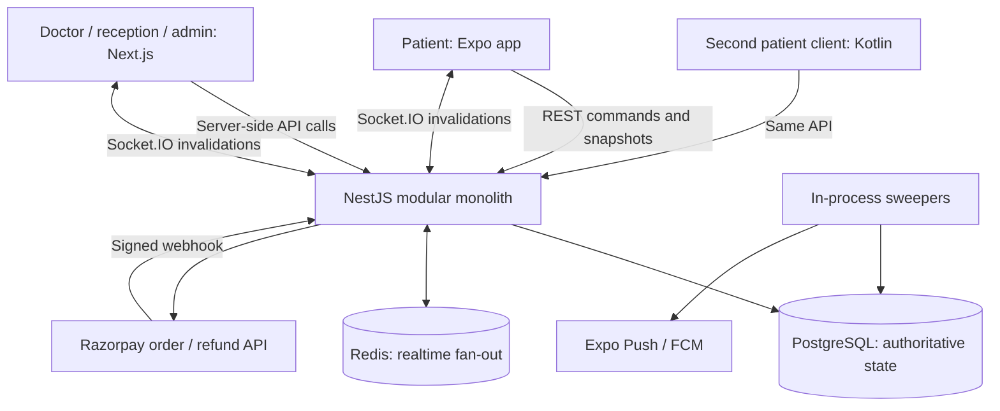

# Kramya: architecture, code, UX, and pilot readiness review

Reviewed 15 October 2026. Scope: 3–4 hospitals/clinics and approximately 300–400 initial patients. The founder confirmed that existing Render data was fictional and a fresh database is acceptable. The 300–400 figure is treated as an initial audience, not a claim about simultaneous connections or daily visits.

## Decision

Keep the core architecture. Kramya has a useful modular monolith and substantial domain logic; a framework rewrite would delay learning from clinics. The next release needs security, payment integrity, operational recovery, and a verified patient journey more than additional infrastructure or another visual redesign.

**Do not onboard real patients or process live payments with the current implementation.** The review found an account-takeover path, payment replay defects, and clinic-closing failures. These are specific implementation findings, not a judgment based on the age or origin of the code.

Use **Supabase Free in Mumbai as the proposed replacement Postgres for development and a supervised pilot**, retaining NestJS, Prisma, and Socket.IO. A database move does not make a sleeping Render API dependable during clinic hours. Strictly zero-cost operation is a useful learning stage, not an availability promise to a hospital.

The companion [migration plan](../supabase-migration-plan.md) gives the connection strategy, proposed configuration, verification gates, and cutover sequence. No cloud account, database, deployment, or billing setting was changed in this review.

## Follow-up status — 16 October 2026

PR [#11](https://github.com/pnkjxmwl/kramya/pull/11) has since merged as commit `55dc7df`. It repairs the critical invitation/account takeover, payment capture/refund reconciliation, session closure, and client session/tenant/reconnect defects, with regression coverage and a green CI run. The fresh Supabase project is now migrated and the Render API's readiness check passes. This resolves the code blockers recorded above for staging, not the operational pilot gates below: the database is empty, the full hosted two-tenant journey and real-device flows remain untested, backups have not been restored, and the free API is not dependable during clinic hours. Findings in this document remain historical observations from 15 October; use the current code and the migration plan before treating any individual finding as open or closed.

## What exists and how it works

| Area            | Actual implementation                                                            | Assessment                                                                                                         |
| --------------- | -------------------------------------------------------------------------------- | ------------------------------------------------------------------------------------------------------------------ |
| Repository      | pnpm workspace + Turborepo; TypeScript backend/web/Expo                          | Keep. One shared contract reduces integration drift.                                                               |
| API             | NestJS feature modules; Prisma; PostgreSQL                                       | Appropriate for the first clinics and well beyond this initial audience if measured and maintained.                |
| Queue           | Command handlers, table-driven transitions, per-session `FOR UPDATE` transaction | Strong core design. Boundary cases below need repair.                                                              |
| Staff console   | Next.js App Router; server components/actions; httpOnly session cookies          | Keep. Reconnection, renewal, and hospital selection need work.                                                     |
| Patient clients | Expo/React Native plus a second Kotlin/Compose Android implementation            | Too much duplicated maintenance for the current team and stage. Prefer one primary patient client.                 |
| Contracts       | Shared Zod schemas and inferred TypeScript types                                 | Keep. Kotlin models are manually mirrored, creating another compatibility burden.                                  |
| Payments        | Server-created Razorpay order; verified webhook; reconciliation/refund sweepers  | Correct overall boundary, incomplete lifecycle/idempotency implementation.                                         |
| Realtime        | Socket.IO; Redis adapter; REST snapshots                                         | Keep realtime as a refresh signal. Add reliable recovery and stale-data indicators.                                |
| Workers         | In-process database polling timers (`Sweeper`)                                   | **Not BullMQ**, despite older stack tables. Reasonable at this stage if always running and work is claimed safely. |
| Redis           | Socket fan-out and health checks in current code                                 | Rate limits are actually process-local; comments claiming Redis-backed limiting are stale.                         |
| Deployment      | Render API + Redis + expiring Postgres; Vercel web; EAS/native builds            | Current configuration is a staging/demo setup.                                                                     |

The normal patient journey is discovery → choose doctor/session and family profile → reserve and pay → receive a token after verified capture → watch an ETA window → arrive and check in → be called → consultation → completion. Reception can also add walk-ins to the same queue. The token is a stable booking label; live call order can change with arrival, priority, and requeue decisions.

Global `Account` and `Patient` records connect to hospital staff memberships and hospital-owned sessions, queue entries, payments, consultations, events, and audit logs. This distinction matters: a flaw that grants a global account session bypasses the benefit of otherwise correct hospital membership checks.

Preserve these strengths: integer paise, centralized queue locking, validation contracts, signed opaque check-in references, post-commit realtime, hashed refresh/invitation tokens, owner checks on patient bookings, QR/manual check-in alternatives, and existing concurrency/tenant tests.

## Launch-blocking code findings

Paths below are repository-relative with one-based lines from the reviewed source. These are starting points for repairs, not claims that all nearby code is defective. P0 means immediate security blocker; P1 means fix before a real clinic pilot; P2 means a significant follow-up or release-quality defect.

### F01 · P0 · Staff invitations can authenticate as another existing account

`apps/api/src/modules/staff/staff.service.ts:56` upserts a global account by the supplied email and line 108 returns the invitation secret to the inviting administrator. The acceptance route is public (`auth.controller.ts:71`). `auth.service.ts:86` retains an existing password hash without verifying the submitted password, then line 96 issues an account-wide session.

An administrator of clinic A can invite an existing user of clinic B into A, consume the returned token, and receive that user's access/refresh tokens. B's membership checks then operate as the victim. A Google-only account can also acquire the attacker's password because its hash is null.

An isolated service reproduction with persistence/token stubs confirmed: invitation returned to admin; accepted without victim password; tokens issued for the victim; original password unchanged. No real account was accessed. The existing test at `apps/api/test/accept-invite.e2e.test.ts:131` checks password preservation, but misses the returned session.

**Repair:** require existing users to sign in as the invited account before activating membership. A token known to an administrator must never authenticate an existing global identity. Verify recipient ownership for new accounts. Consume the exact invitation hash and expiry atomically. Add cross-clinic, existing-password, Google-only, reissued-token, expired-token, and concurrent-acceptance tests. Before reusing an exposed environment with real users, assess and revoke affected sessions.

### F02 · P1 · Replayed payment captures can resurrect cancelled bookings or duplicate refunds

`apps/api/src/modules/payments/payments.service.ts:489` recognizes duplicates only while status is `SUCCESS`. After a refund changes that status, the same capture is processed again. At line 516, a deliberately cancelled booking is treated like an expired reservation and can be reinstated; line 535 resets the payment to `SUCCESS`. On an ended session, lines 502–510 raise another refund. `raiseRefund` at line 839 creates a row and increments the refund total without a single transaction or upper-bound invariant.

An isolated reproduction sent the same captured payment twice after session end: two refund rows, two gateway requests, and ₹1,000 recorded refunded against a ₹500 payment. A real gateway may reject the second full refund; **duplicate payout was not proven**. The duplicate request and corrupt local ledger were reproduced.

**Repair:** persist capture identity independently of current payment status; make capture handling, cancellation reason, and refund obligation decisions under a consistent lock. Use a unique refund business key and enforce total refunds ≤ captured amount. Keep network calls outside database transactions. Test capture → cancellation/refund → duplicate capture, late capture after end, concurrent duplicates, and gateway-success/database-failure recovery.

### F03 · P1 · Payment reconciliation can starve newer paid orders

`payments.service.ts:347` always chooses the oldest 20 `CREATED/PENDING` orders. When an order has no captured attempt, line 362 leaves it unchanged. Twenty abandoned checkouts can fill every later sweep, preventing recovery of newer payments whose webhook was lost. `FAILED` orders are excluded even though the same order can later succeed.

**Repair:** persist next-check time, attempts, and fair cursor/claim progression; back off abandoned orders while continuing to inspect later unresolved ones. Add a regression with 20 abandoned orders followed by one captured order. Reconcile unsettled refunds too: lines 401 and 432 only recover missing gateway IDs and can leave a settled refund locally `PENDING` after a lost webhook.

### F04 · P1 · Session closure has three incomplete outcomes

`apps/api/src/modules/queue/commands/end-session.ts:91` excludes `RESERVED`, while expiry is forbidden after session end (`state-machine.ts:383`). Unpaid reservations remain active indefinitely. The same query includes `SKIPPED`, but the `END_SESSION` transition table (`state-machine.ts:311`) has no skipped transition: one skipped patient prevents closing the whole clinic. This rejection was also checked with isolated state-machine execution.

For present patients not seen, the command assigns terminal `RESCHEDULED` but creates no replacement visit, refund, or tracked resolution. Ordinary cancellation is then blocked on the ended session.

**Repair:** define and test the outcome for every entry state. Cancel unpaid holds within closure; resolve skipped entries deliberately; create an explicit refund/rebooking/support obligation for paid patients not seen. The user-facing word “rescheduled” must mean an actual agreed new booking. Until then, say “Clinic ended — reception will help arrange the next step” and track that obligation visibly.

### F05 · P1 · Account changes do not safely reset patient state and push ownership

Expo's app-lifetime QueryClient (`apps/mobile/app/_layout.tsx:107`) uses endpoint-only keys (`lib/api.ts:36`). Logout (`lib/auth.tsx:124`) clears tokens without cancelling requests or clearing private cached data. Another user can briefly or persistently see the previous user's profile/visits when refetch fails.

`apps/mobile/lib/push.tsx:51` marks registration complete before it succeeds and never resets the flag. Signing in as B after A in the same process can leave the token owned by A, so B misses notifications and A's notifications may still arrive. The registration response is not checked. The backend reassigns ownership only when registration is called (`notifications.service.ts:57`).

**Repair:** a single account-transition lifecycle that cancels private requests, clears/namespaces cache, disconnects old sockets, and unregisters/reassigns push tokens. Register by account + device token, record success only after a successful response, and retry transient failure. Test two users sharing a phone, logout during an in-flight request, expired sessions, and initial push registration failure.

Native explicitly clears cache on the Profile sign-out action, but automatic session loss does not; its cache clear also does not cancel in-flight work. Do not describe both clients as having identical logout behavior.

### F06 · P1 · Session renewal is fragile under ordinary clinic conditions

`apps/web/middleware.ts:22` independently rotates the refresh token for concurrent protected requests. Backend replay detection (`token.service.ts:73`) revokes a family after reuse. Two tabs/prefetches near expiry can therefore log out a legitimate staff member. A process-local lock alone would not solve this on multiple serverless instances.

The web middleware at line 27, Expo `lib/auth.tsx:160`, and native `net/Auth.kt:167` also treat transport/5xx refresh errors as invalid identity and erase credentials. A Render cold start or poor connection becomes forced logout.

**Repair:** coordinate renewal across requests without disabling replay protection; distinguish explicit auth rejection from transient availability failures. Retain recoverable credentials and display reconnect state. Test concurrent requests with the same expiring session and recovery from a refresh 503.

### F07 · P1 if native ships · Token storage silently falls back to plaintext

`apps/native/app/src/main/java/app/kramya/net/Auth.kt:255` catches encrypted-store initialization failure and uses ordinary preferences; line 273 stores bearer credentials there.

**Repair:** recover/reset secure storage and reauthenticate, or remain explicitly ephemeral. Never silently persist the refresh token unencrypted. This is a distribution blocker if the Kotlin client is retained.

## Other code and architecture findings

| ID  | Priority         | Evidence and implication                                                                                                                                                      | Recommended change                                                                                                                              |
| --- | ---------------- | ----------------------------------------------------------------------------------------------------------------------------------------------------------------------------- | ----------------------------------------------------------------------------------------------------------------------------------------------- |
| F08 | P2               | `apps/web/app/(console)/queue/live.tsx:59` obtains one handshake token per mount; lines 85–86 only mark errors. Reconnect after token expiry fails, with no polling fallback. | Renew handshake credentials; bounded reconnect; REST fallback; last successful snapshot timestamp.                                              |
| F09 | P2               | Expo `lib/realtime.tsx:122` and native `net/Realtime.kt:110` track room consumers in a Set. One screen disposing a shared watch removes another screen's subscription.        | Reference-count room consumers and test nested screens.                                                                                         |
| F10 | P2               | `apps/web/app/login/page.tsx:30` accepts `//external.example` via `startsWith('/')`.                                                                                          | Resolve return URLs against the current origin and allow only same-origin destinations.                                                         |
| F11 | P2               | Login `page.tsx:19` and invite `page.tsx:39` lack transport-error cleanup; invite success at line 47 navigates to the now-public `/`.                                         | Catch/finally, retryable error, then route successful invite to `/overview` or setup.                                                           |
| F12 | P2               | `apps/web/lib/tenant.ts:63` chooses first active membership; line 37 chooses first admin membership. Shell and config may describe different hospitals.                       | Explicit selected hospital, consistently verified server-side across shell, reads, and commands. No backend tenant bypass was established here. |
| F13 | P2               | `apps/api/prisma/schema.prisma:182` makes `Doctor.accountId` globally unique.                                                                                                 | Model clinician identity plus hospital assignment, or uniqueness per hospital, if the same visiting doctor works at several clients.            |
| F14 | Product decision | `queue.controller.ts:105` allows any hospital doctor to operate another doctor's session.                                                                                     | Agree assignment/delegation policy with pilot clinics; enforce it on the backend, not only in navigation.                                       |
| F15 | Before replicas  | `common/sweeper.ts:44` prevents overlap only inside one process. Rate limits are also per process.                                                                            | Database claims/leases and retry identities for external work; shared rate limiting before a second API replica.                                |
| F16 | P2               | Documentation claims BullMQ, Redis rate limiting, teal console styling, and completed reservation cleanup while implementation differs.                                       | Keep one current architecture description; move history to decision records; test executable guarantees.                                        |

## UI and user satisfaction

### What was actually inspected

The deployed landing page, `/demo`, `/demo/queue`, and `/login` were inspected in a browser. The queue board was checked at **390×844** and **1280×900**, and sample Complete consultation → Call next interactions worked. The demo explicitly uses sample data and local state. This verifies those demo screens and interactions, not the authenticated backend or the currently checked-out commit.

The existing black/white visual system is coherent. The dominant patient token and one primary consultation button work well. Mobile stacking remained readable at the inspected width; desktop separated the current patient from rosters clearly. Keep that structure.

The Expo and Kotlin screens were reviewed in source, **not rendered on a real device during this review**. `apps/native/PARITY.md:11` explicitly records that native rendering, checkout, sockets, and push delivery were never verified in its original build. That is a release gate, not evidence that the UI is broken.

### Changes with the highest customer value

| Surface               | Proposed experience                                                                                                           | Acceptance evidence                                                                                             |
| --------------------- | ----------------------------------------------------------------------------------------------------------------------------- | --------------------------------------------------------------------------------------------------------------- |
| Hospital landing/link | Scan clinic QR or open shared link → correct clinic/session; browse without account; authenticate only when booking.          | First-time patient reaches the intended doctor without searching a city hierarchy or creating an account first. |
| Booking               | Patient/family selection, fee and cancellation terms, availability, one clear pay/join action, then recoverable confirmation. | Back/retry/app-kill never charges twice or loses an already-paid token.                                         |
| Patient token         | Token, estimated window, doctor presence, people ahead, last update, and one next action.                                     | Patient can answer “Am I booked? When should I arrive? What do I do now?” within seconds.                       |
| Offline patient       | Cached token visibly dated; reconnect control; reception contact; notification readiness shown without blocking booking.      | Airplane-mode and background/resume tests retain identity and never present stale estimates as live.            |
| Reception             | Fast scan/search/walk-in; clear pending-payment/refund exceptions; counts from whole session, not a paginated subset.         | Staff completes typical check-in without training help; errors do not require a developer.                      |
| Doctor                | Current patient and one dominant call/start/complete action; break/resume; safe closure with unresolved-patient summary.      | Routine visit takes minimal interactions; ending the session explains who is still owed care/refund.            |
| Admin                 | Clinic setup checklist, staff list/invite/disable, schedules, fee/policy review, hospital switcher, support contacts.         | A clinic can operate the next day without shell commands or founder intervention for ordinary staff changes.    |
| Marketing             | Working demo/contact conversion, honest pilot availability, privacy/support links, real customer evidence when earned.        | A clinic lead can contact the founder successfully; no unsupported production/traction claims.                  |

Specific source findings: patient discovery is gated behind sign-in (`apps/mobile/app/_layout.tsx:60`); tapping a hospital row usually selects a featured card and scrolls upward instead of opening the hospital (`(discover)/index.tsx:303`). Search mode changes that tap behavior. Use one direct navigation behavior.

Accessibility needs concrete fixes: Expo `theme.ts:45` and native `core/Theme.kt:41` use `#8A8A8E` for small text, approximately **3.21:1** on `#F7F7F8`, below the project's 4.5:1 body-text target. `apps/mobile/lib/ui.tsx:156` does not explicitly associate its input with the sibling label. Web control sizes in `components/ui.tsx:33` are 28/36px with no touch adaptation. Darken semantic text, associate labels, and ensure 44px effective touch targets on tablet/mobile layouts. Test large text and screen readers on devices.

The public demo has a fixed “Friday, 13 September” context while its ETA uses the viewer's current time. During inspection a 10 AM–1 PM session showed an evening ETA alongside “On its usual pace.” Give the demo one consistent simulated clock. Its Call next also skips straight to in-consultation while the live workflow has a separate start step; label it a simplified demo or match the real sequence.

Marketing currently says the product is “in pilot with its first hospitals” and that the demonstration uses engine-produced numbers. The founder described onboarding as planned, and `app/reveal.tsx` contains hardcoded stages. Verify the claim or change it to “Recruiting pilot clinics” and label the animation an illustration. `app/page.tsx:514` still uses the contact documented as a placeholder. Claims such as “access is logged” should match actual patient-data access logging, not merely generic HTTP logs.

## Target architecture and missing operations

Keep one modular API and one Postgres database shared by hospitals with enforced tenant boundaries. Use separate staging and pilot environments, not one database per hospital just to fit free project quotas. Keep database credentials entirely server-side.

Inside the existing application, add a **payment-event inbox** and durable **refund/resolution obligations**. Commit business state and required side effects together; workers claim and retry external delivery outside the transaction. This is a small reliability pattern within the monolith, not a need for microservices, Kafka, or an event-sourced rewrite.

Retain DB sweepers initially, but give them fair progress, backoff, work claims, last-success timestamps, and alerts for oldest pending work. Reconcile after an outage. Split API and worker processes only when operating needs justify it. Running both in a sleeping free service cannot provide timely nudges.

Treat Socket.IO messages as invalidations, never commands to accept as truth. Snapshot recovery, version checks, token renewal, and polling must survive missed events. An offline board should show a timestamp and restrict actions that require fresh state while allowing the server to reject conflicts safely.

For this stage, **prefer Expo as the actively developed patient client** and preserve Kotlin pending a measured reason to maintain it. This is a recommendation, not a deletion performed here. Kotlin duplicates screens, contracts, auth, cache, and networking. If it becomes strategic, generate models and add contract compatibility tests.

Missing operating capabilities before broader onboarding:

- Password/account recovery; verified identity; secure session/device management.
- Staff offboarding, invitation revocation, and role changes with audit history.
- A real clinic cancellation/refund/rebooking resolution workflow and operator exception view.
- Privacy notice/consent records where required, data access logging, retention/export/deletion procedures, and a documented clinic data-handling agreement. Region alone is not compliance; confirm applicable obligations with qualified advice.
- Backups outside the primary failure domain, a tested restore procedure, incident owner, and clinic fallback procedure.
- Worker lag, failed payment recovery, pending refund age, error-rate, availability, and storage/egress alerts.
- Doctor substitution if pilot clinics need it; schema fields alone do not implement the workflow.
- A working support route, photo upload/management if necessary, and language/accessibility validation with actual patients.

## Free hosting decision

| Component      | Recommendation now                                        | Constraint                                                                                                  |
| -------------- | --------------------------------------------------------- | ----------------------------------------------------------------------------------------------------------- |
| PostgreSQL     | Supabase Free, Mumbai                                     | 500 MB DB, two active projects, 5 GB egress, inactivity pausing; independent exports needed.                |
| API + workers  | Existing Render Free only for demos/supervised validation | Sleeps after 15 minutes idle; workers stop. Choose an always-on host before depending on it during clinics. |
| Web console    | Evaluate Netlify Free with a preview deployment           | Commercial use/no-card supported, but 300 shared credits/month and hard-limit pausing require measurement.  |
| Redis          | Keep existing adapter for now                             | Ephemeral Redis must not be the only store of payment/refund work.                                          |
| Patient client | Existing Expo build workflow                              | Complete physical-device checkout, push, and background/resume tests before distribution.                   |

Verified provider facts on 15 October 2026: [Supabase pricing](https://supabase.com/pricing), [regions](https://supabase.com/docs/guides/platform/regions), [backup guidance](https://supabase.com/docs/guides/platform/backups), [Render free limits](https://render.com/docs/free), [Netlify commercial/no-card policy](https://www.netlify.com/blog/introducing-netlify-free-plan/), [current Netlify limits](https://www.netlify.com/pricing/), and [Next.js compatibility](https://docs.netlify.com/build/frameworks/framework-setup-guides/nextjs/overview/).

[Vercel Hobby](https://vercel.com/docs/plans/hobby) explicitly restricts use to personal, non-commercial projects. Do not assume a clinic startup qualifies just because the pilot charges nothing. Netlify is a candidate, not a verified deployed replacement; validate middleware, cookies, Server Actions, API proxying, and sockets there.

[Neon Free](https://neon.com/docs/introduction/plans) is a credible alternative with 1 GB/project and 100 CU-hours/project/month. However, this app's 15–30-second database sweeps can prevent compute sleep. At 0.25 CU, 100 CU-hours allows about 400 active hours; a month of continuous activity needs about 180–186 CU-hours. This is an inference from code and metering, not a measured bill. It makes Supabase a better fit for the present architecture.

Supabase Mumbai meets the repository's database-location preference. The existing API is in Singapore; measure cross-region transaction latency and plan to co-locate API/worker/database. India database hosting alone does not mean all processing, logs, backups, or notifications stay in India.

## Pilot sequence and evidence to earn

1. **Integrity gate:** fix F01–F07 as applicable, plus payment/refund settlement recovery; add regression tests for the exact failures. No real patients or live money before this gate.
2. **Restore staging:** provision fresh Supabase, apply migrations, create fictional tenants, run the journey and failure tests, and prove export/restore. Evaluate a commercial-compatible web host.
3. **Observe one clinic first:** run alongside its current process; establish baseline wait, staff effort, no-shows, and arrival behavior. Agree downtime and manual reconciliation procedures.
4. **Supervised operating pilot:** use suitable uptime, train reception, support every session, and track exceptions. Make the current patient's next action and staff recovery flows reliable.
5. **Expand to 3–4 clinics:** only after the first clinic repeatedly completes sessions, reconciles money, and wants to keep using the product.

Suggested acceptance targets to validate, not claims of achieved performance: no cross-account data leakage; every captured payment has one token or one tracked refund/resolution; no duplicate refund obligation on replay; all entry states close correctly; reconnect catches up automatically; a real-device notification opens the correct booking; restore succeeds in a fresh environment.

Load-test realistic concurrency rather than equating 400 users with 400 simultaneous bookings. Test both an initial few hundred registered patients and an explicit stress scenario of 400 visits/day across four clinics, with a burst of joins, two receptionists acting on the same session, lost webhooks, and DB/API restarts. Record transaction lock wait, p95 response time, failed commands, DB growth, connection count, and worker age. Choose pass thresholds with the clinics; they have not been measured here.

Database quota forecasting should use actual bytes per visit, including indexes, `QueueEvent`, `AuditLog`, notifications, and token history. Forecast runway from remaining storage divided by observed daily growth. Set alerts around 60/75/85% of storage and egress, and upgrade before the next busy period would breach a limit. Never silently delete audit history to remain free.

## Startup and YC direction

No architecture or UI can guarantee YC acceptance. The useful evidence is that clinics adopt the product, patients save time, and the economics can support delivery. YC's own [startup guidance](https://www.ycombinator.com/library/4D-yc-s-essential-startup-advice) emphasizes launching, talking to users, and iterating on a real need.

Start with a narrow segment: clinics with recurring OPD queues, a receptionist who will use the board, and an owner willing to share baseline numbers. Sell a dependable reduction in uncertainty and reception work. Do not claim reduced waiting simply because patients move it from the clinic to home; measure physical wait separately from time-to-consultation.

| Question                  | Metric to collect                                                                   | Why it matters                                                        |
| ------------------------- | ----------------------------------------------------------------------------------- | --------------------------------------------------------------------- |
| Are patients better off?  | Median/p90 physical waiting; arrivals too early/late; ETA-window coverage           | Proves the product benefit without promising exact appointment times. |
| Does staff keep using it? | Sessions operated each week; check-in time; manual workarounds                      | Shows operational adoption, not just account signups.                 |
| Does booking work?        | Join → payment → token conversion; failed/duplicate charge incidents; recovery time | Reveals trust and revenue leaks.                                      |
| Is ETA improving?         | Predicted window vs actual consultation time, by clinic and doctor                  | Tests the distinctive part of the product.                            |
| Will someone pay?         | Pilot renewal, paid conversion, recurring clinic revenue, support effort            | Establishes sustainable value.                                        |
| Can it expand?            | Time to onboard the next clinic; founder interventions per session                  | Exposes product and service costs before adding customers.            |

Prefer clinic subscriptions as a pricing hypothesis to test, with transaction fees and patient convenience charges made transparent if introduced. Do not choose a price or claim willingness to pay without clinic interviews. Avoid building an EMR, AI diagnosis, marketplace expansion, or microservices to look more ambitious before the queue workflow is trusted.

## Verification record and limits

- Read repository guardrails, product/architecture/design/build history, schema and deployment configuration; parallel reviews examined backend and all clients.
- Isolated mocked-service reproductions confirmed the invitation takeover and late-capture duplicate-refund path. Isolated state-machine execution confirmed skipped-entry closure rejection. These did not mutate a database or call payment services.
- Public web visual inspection covered landing, demo overview/board, sign-in, 390px/1280px layouts, and two demo transitions. Authenticated clinic flows and patient-device pixels were not verified.
- Initial lint/typecheck and contracts-test commands could not start: installed junctions still pointed at `C:\Projects\New folder` after the workspace rename. The sandboxed offline repair stalled; an approved frozen-lockfile reinstall restored all workspace links, and Prisma Client was regenerated. No dependency versions or lockfile were changed.
- Fresh results: **38 contract tests and 122 backend unit tests passed**. The backend run used a temporary unit-only Vitest configuration with database setup disabled; that file was removed afterward. Workspace package lint passed with two existing `no-console` warnings in `apps/api/src/seed.ts`; all TypeScript package checks passed. The root Turbo wrapper could not locate a bare `pnpm` binary, so package scripts were run through `corepack pnpm -r --if-present lint/typecheck`. This is not a successful full `pnpm test` or production build claim.
- Runtime configuration also needs alignment: `.node-version` selects Node 24.16.0, whereas `.github/workflows/ci.yml` installs Node 20. The checks above used the local pinned Node 24 runtime. The new Markdown/YAML artifacts were parsed/formatted with Prettier, and `git diff --check` passed.
- Docker was not available through the local engine pipe. No full real-Postgres integration or live-payment test result is claimed. The API's test setup creates/truncates a dedicated test DB; never aim it at the new Supabase pilot database.
- No live Render dashboard state was inspected. A source note records an October 8 expiry, but that is not proof of current deletion. User confirmation that the data is disposable removes recovery from the critical path.
- Historical test totals in `PROGRESS.md` are prior evidence, not a fresh green test run. Expo's `test` script is explicitly a successful no-op. Native JVM compilation/tests do not establish device behavior.

This review produces a prioritized repair plan and migration design. The identified production defects remain open until repaired and verified; no phase-completion box should be ticked on the strength of this report.
